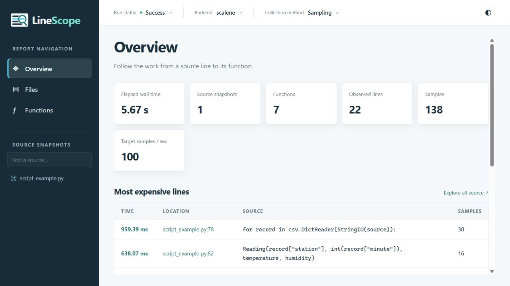
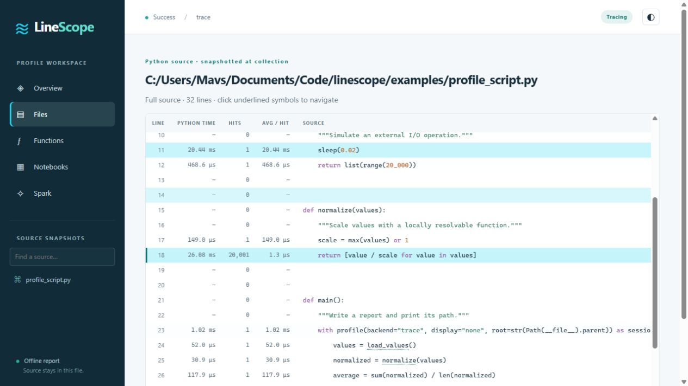

# Reports

Open **Overview** to find expensive lines, then follow a source link.

## Views

| View | Contents |
| --- | --- |
| Overview | Most expensive lines |
| Files | Files and notebook cells |
| Functions | Function totals, calls, and averages |
| Memory | Process RAM growth and timeline |
| GPU | Sampled device time and memory |
| Spark | Actions, query plans, and operator costs |

Memory, GPU, and Spark appear when their data is available. Select a column
heading to sort; select it again to reverse. **Source** restores line order.
**Heatmap by** highlights time or positive memory growth.

## AI suggestions

Select the AI icon beside a source line or on a Spark view. See
[AI suggestions](ai.md) for setup and context options.

## Report header

### Run status

**Failed** keeps measurements collected before the error. **Reference** notebook
entries belong to their parent run.

### Backend collector

The selected [collector](backends.md): Trace, Scalene, Tachyon, or a custom one.

### Collection method

**Tracing** records events; **Sampling** estimates time from observations.
**Mixed collection** combines collectors.

## Line columns

| Column | Meaning |
| --- | --- |
| Time | Attributed line time; estimated with sampling |
| Samples | Observations, not execution counts |
| Hits | Recorded executions |
| Avg / hit | Time divided by hits |
| Mem Change | Accumulated process RAM change during the line |
| Peak Mem | Highest observed process RAM during the line |
| GPU time | Estimated device work |
| GPU peak memory | Highest sampled device memory |
| Context | Spark actions or child notebooks |
| Source | Captured code |

A dash means unavailable. Zero samples do not prove a line never ran.

In **Functions**, **Time** totals a function's own lines across all calls,
excluding other project functions it calls. **Avg / call** divides Time by
**Calls**. If profiling starts inside a function, its time is kept but Calls
and Avg / call are unavailable because its entry was missed.

## Profiling scope

Elapsed time includes waits, not summed worker CPU time. Thread coverage depends
on the [backend](backends.md#profiling-scope). See [Spark scope](spark.md#scope)
for distributed workloads and [memory](backends.md#memory) for RAM limits.

## Source snapshots

Reports contain the code that ran. Notebook cells retain their numbers and
executed versions; line numbering restarts in each cell. Library costs are
attributed to the calling project line.

## Source navigation

Select an underlined name to open its definition. Ambiguous definitions and
third-party calls stay unlinked. Browser back and forward retrace navigation.

## Saving and sharing

`session.save("report.html")` writes a self-contained report that works offline.
Review its source, paths, and metadata before sharing.
